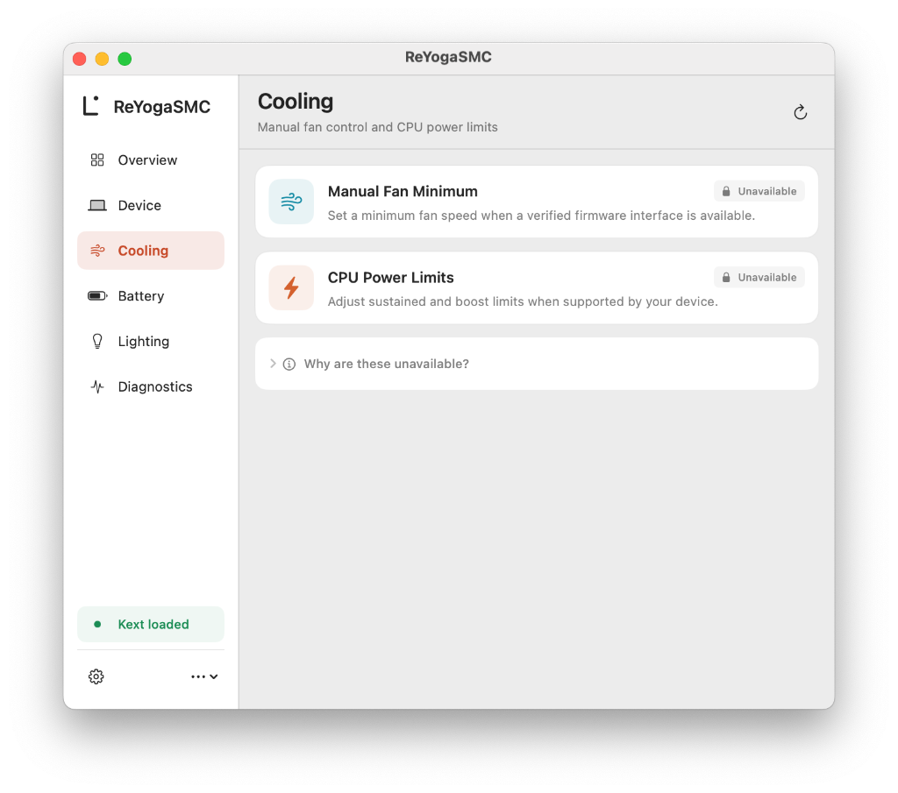

<div align="center">

<picture>
  <source media="(prefers-color-scheme: dark)" srcset="Assets/Brand/readme-dark.svg">
  
</picture>

[](https://github.com/hoaug-tran/ReYogaSMC/actions/workflows/main.yml)
[](https://github.com/hoaug-tran/ReYogaSMC/releases/latest)
[](LICENSE)

Kernel extension (`ReYogaSMC.kext`), macOS app (`ReYogaSMC.app`), and hardware support tool for Lenovo ThinkPad, IdeaPad, Yoga, LOQ, and Legion laptops on macOS.  
Forked from [YogaSMC 1.5.3](https://github.com/zhen-zen/YogaSMC).

[Releases](https://github.com/hoaug-tran/ReYogaSMC/releases/latest) - [Actions builds](https://github.com/hoaug-tran/ReYogaSMC/actions/workflows/main.yml) - [Hardware profiles](HardwareProfiles) - [Compatibility](Docs/compatibility.md) - [Hardware tool](Docs/hardware-tool.md)

</div>

---

## Overview

ReYogaSMC connects Lenovo ACPI (`VPC0` and `HKEY`), Lenovo WMI (`PNP0C14`), `AppleSmartBattery`, `AppleSMC`, and ITE USB RGB controllers to macOS. Control requests run through the driver's `IOCommandGate`, check firmware capability flags, and read back hardware state before reporting success.

<p align="center">
  
</p>

---

## Supported features

Available controls and sensors depend on what the laptop's firmware and connected devices expose:

| Interface | Provider | Supported features |
| :--- | :--- | :--- |
| **ThinkPad ACPI** | `ThinkVPC` (`LEN0068` / `LEN0268` `HKEY`) | Fn hotkeys, Fn Lock, keyboard backlight, battery start/stop charge thresholds (`BCTG`/`BCCS`/`BCSG`/`BCSS`), inhibit charge, force discharge, DYTC thermal profiles, mute/mic-mute LEDs, and serialized dual-fan EC control (`kRYSMCUCThinkFan`) |
| **IdeaPad / Yoga / Legion / LOQ ACPI** | `IdeaVPC` (`VPC0`) | Battery conservation mode (`GBMD`/`SBMC`), rapid charge, keyboard backlight (`HALS`/`SLBL`), Fn Lock, Always-On USB, native ACPI EC sensors (`FANS`, `FA2S`, `CPUT`, `GPUT`), and reviewed `RYID` ACPI bridge support |
| **Lenovo Game Zone WMI** | `IdeaWMIGameZone` | Thermal modes (`Quiet`, `Balanced`, `Performance`), `Fn+Q` full-speed cooling, opt-in CPU boost and sustained power limits (`-reycpupower`), display overdrive, touchpad lock, Win key lock, Y-logo LED, rear port lighting, and WMI sensor fallback |
| **Intel HID / HP WMI** | `ReYogaHIDD` (`INT33D5`), `DYVPC` | HID DSM Fn hotkeys, Yoga mode events, and HP WMI thermal/event sensors |
| **Smart battery** | `AppleSmartBattery` | Charge percentage, charging state, current/full-charge/design capacity (mAh), design health percentage, cycle count, voltage (V), signed current (mA), power draw (W), temperature (°C), and AC adapter watt rating |
| **SMC sensors** | `AppleSMC` | Read-only CPU (`TC0E`, `TC0P`, `TC0D`, `TC0F`, `TC0C`, `TC1C`, `TCSA`) and GPU (`TG0D`, `TG0P`, `TG0E`) temperature keys |
| **ITE `c968` USB RGB** | `IOHIDManager` (`0x048d:0xc955/0xc965/0xc967/0xc975/0xc985`) | Built-in lighting effects, speed, 2-level brightness, 4-zone static RGB colors, and per-key RGB JSON profile import |

> [!NOTE]
> `AppleSmartBattery`, `AppleSMC` temperature sensors, and ITE `c968` USB RGB run directly in userspace. They remain usable even when `ReYogaSMC.kext` is not loaded, is started with `-reysafe`, or does not match a Lenovo VPC device.

---

## Supported laptops and hardware profiles

ReYogaSMC supports two categories of Lenovo laptops:

### 1. ThinkPad, Yoga, IdeaPad, and older Lenovo laptops

Most Lenovo laptops **do not need** a profile file in [`HardwareProfiles/`](HardwareProfiles):

- **ThinkPad series (T, X, X1 Carbon, P, L, E, etc.):** Controlled dynamically through standard ThinkPad `HKEY` ACPI methods (`ThinkVPC`). Battery charge thresholds, Fn hotkeys, Fn Lock, keyboard backlight, DYTC thermal modes, and ThinkPad fan control work across generations without per-model JSON profiles.
- **Yoga, IdeaPad, and older Lenovo laptops:** Controlled through standard `VPC0` ACPI methods (`IdeaVPC`) and Lenovo WMI (`IdeaWMI`). Battery conservation mode (`GBMD`/`SBMC`), rapid charge, keyboard backlight (`HALS`/`SLBL`), Fn Lock, Always-On USB, hotkeys, and WMI thermal modes work automatically on any laptop whose DSDT exposes those standard methods.

### 2. Legion, LOQ, IdeaPad Gaming, and Yoga Slim profiles

On newer Lenovo gaming and consumer laptops, fan speeds (`FANS`, `FA2S`) and EC temperatures (`CPUT`, `GPUT`) are stored in model-specific ACPI EC fields instead of standard `VPC0` methods. For those machines, `IdeaVPC` uses [`HardwareProfiles/`](HardwareProfiles) to verify the laptop before reading its ACPI EC sensors:

1. **DSDT header check:** Valid `DSDT` signature, byte length (`36 .. 1048576` bytes), 8-bit checksum (`0x00`), and `LENOVO` OEM ID.
2. **OEM table ID:** Matches the profile's `oem_table_ids` (such as `CB-01`).
3. **Machine type and BIOS family:** Checked across `/`, `/efi/platform`, `IOPlatformExpertDevice`, `/options` NVRAM (`OEMProduct`, `OEMBoard`, `OEMBIOSVersion`), and `AppleSMBIOS` Type 0 / Type 1 strings, or matched by a model-specific Lenovo PCI subsystem ID (`17aa:xxxx`).
4. **Conflict rejection:** If two identity sources disagree (`conflict`) or multiple profiles match (`ambiguous`), model-specific EC reads are disabled while standard ACPI, WMI, battery, and SMC features stay active.

| Profile ID | Model name | Machine types | BIOS families | EC path |
| :--- | :--- | :--- | :--- | :--- |
| `ideapad_gaming_3_15arh05` | IdeaPad Gaming 3 15ARH05 | `82EY` | `FCCN` | `\_SB.PCI0.LPC0.EC0` |
| `ideapad_gaming_3_15ach6` | IdeaPad Gaming 3 15ACH6 | `82K2`, `82MJ` | `H3CN` | `\_SB.PCI0.LPC0.EC0` |
| `legion_5_15arh05` | Legion 5 15ARH05 / 15ARH05H / R7000P2020H | `82B5`, `82B1`, `82GN` | `EUCN`, `FSCN` | `\_SB.PCI0.LPC0.EC0` |
| `legion_5_15imh05` | Legion 5 15IMH05 / 15IMH05H / 17IMH05H | `82AU`, `81Y6`, `81Y8` | `EFCN` | `\_SB.PCI0.LPCB.EC0` |
| `legion_5_15ach6` | Legion 5 15ACH6 / 15ACH6A / 15ACH6H / 17ACH6H | `82JW`, `82NW`, `82JU`, `82K0` | `HHCN`, `GKCN` | `\_SB.PCI0.LPC0.EC0` |
| `legion_5_15arh7` | Legion 5 15ARH7 / 15ARH7H | `82RE`, `82RD` | `JUCN` | `\_SB.PCI0.LPC0.EC0` |
| `legion_5_pro_16ach6h` | Legion 5 Pro 16ACH6H / R9000P2021H | `82JQ`, `82GR` | `GKCN` | `\_SB.PCI0.LPC0.EC0` |
| `legion_5_pro_16iah7h` | Legion 5 Pro 16IAH7H / 5 15IAH7H | `82RF`, `82RB` | `K1CN` | `\_SB.PC00.LPCB.EC0` |
| `legion_7_15imh05` | Legion 7 15IMH05 / S7 15IMH5 | `81YT`, `82BC` | `E9CN`, `F5CN` | `\_SB.PCI0.LPCB.EC0` |
| `legion_7_16achg6` | Legion 7 16ACHg6 / R9000K2021H (`17aa:3801`/`3802`/`3803`/`381b`) | `82N6`, `82K6` | `GKCN` | `\_SB.PCI0.LPC0.EC0` |
| `legion_7_16ithg6` | Legion 7 16ITHg6 / S7 16IAH7 | `82K8`, `82TF` | `H1CN`, `JYCN` | `\_SB.PC00.LPCB.EC0` |
| `legion_7_16arha7` | Legion 7 16ARHA7 / Slim 7 16ARHA7 | `82UH`, `82UG` | `K9CN` | `\_SB.PCI0.LPC0.EC0` |
| `legion_pro_5_16arx8` | Legion Pro 5 16ARX8 / Pro 7 16ARX8H | `82WM`, `82WS` | `LPCN` | `\_SB.PCI0.LPC0.EC0` |
| `legion_pro_5_16irx8` | Legion Pro 5 16IRX8 / Slim 5 16IRH8 | `82WK`, `82YA` | `KWCN`, `M2CN` | `\_SB.PC00.LPCB.EC0` |
| `legion_pro_5_16irx9` | Legion Pro 5 16IRX9 / Legion 7 16IRX9 | `83DF`, `83FD` | `N0CN`, `N9CN` | `\_SB.PC00.LPCB.EC0` |
| `legion_pro_7_16irx8h` | Legion Pro 7 16IRX8H | `82WQ` | `KWCN` | `\_SB.PC00.LPCB.EC0` |
| `legion_pro_7_16irx9h` | Legion Pro 7 16IRX9H | `83DE` | `N2CN` | `\_SB.PC00.LPCB.EC0` |
| `loq_15aph8` | LOQ 15APH8 / Legion Slim 5 16APH8 | `82XT`, `82Y9` | `LYCN`, `M3CN` | `\_SB.PCI0.LPC0.EC0` |
| `loq_15irh8` | LOQ 15IRH8 / 16IRH8 | `82XV`, `82XW` | `LZCN` | `\_SB.PC00.LPCB.EC0` |
| `loq_15ahp9` | LOQ 15AHP9 / Legion Slim 5 16AHP9 | `83DX`, `83DH` | `NZCN`, `NRCN` | `\_SB.PCI0.LPC0.EC0` |
| `yoga_slim_7_14are05` | Yoga Slim 7 14ARE05 / IdeaPad 5 15ARE05 | `82A2`, `81YQ` | `DMCN`, `E7CN` | `\_SB.PCI0.LPC0.EC0` |

> [!IMPORTANT]
> Matching a hardware profile enables read-only ACPI sensor polling (`FANS`, `FA2S`, `CPUT`, `GPUT`) with automatic per-sensor fallback to WMI if an ACPI field returns an invalid reading. Matching a model never enables raw EC writes.

---

## Temperature sensors

ReYogaSMC reads temperatures from Lenovo firmware (`CPUT`, `GPUT`, or Game Zone WMI) when available, and falls back to `AppleSMC` keys provided by VirtualSMC sensor plugins:

| Sensor | Required kext or source | SMC keys / firmware fields | Notes |
| :--- | :--- | :--- | :--- |
| **AMD Ryzen CPU** | [**SMCProcessorAMD.kext**](https://github.com/trulyspinach/SMCAMDProcessor) | `TC0E`, `TC0P`, `TC0D`, `TC0F` | Needed on AMD Ryzen laptops when ACPI EC `CPUT` or WMI CPU temperature is unavailable |
| **Intel CPU** | [**SMCProcessor.kext**](https://github.com/acidanthera/VirtualSMC) | `TC0P`, `TC0D`, `TC0C`, `TC1C`, `TCSA` | Included in the official VirtualSMC release archive |
| **AMD Radeon iGPU / dGPU** | [**SMCRadeonSensors.kext**](https://github.com/ChefKissInc/SMCRadeonSensors) | `TG0D`, `TG0P`, `TG0E` | Needed to read AMD Radeon iGPU and dGPU temperatures through `AppleSMC` |
| **NVIDIA dGPU** | Firmware EC (`GPUT`) / WMI only | `GPUT` | Not supported when the dGPU is disabled or patched with [`nullmoth/nvidia-macos-driver`](https://github.com/nullmoth/nvidia-macos-driver) |

> [!WARNING]
> **NVIDIA dGPU temperature:**  
> Laptops that disable the NVIDIA discrete GPU via ACPI (`_OFF`), boot arguments (`-wegnoegpu`), or [`nullmoth/nvidia-macos-driver`](https://github.com/nullmoth/nvidia-macos-driver) do not expose an active NVIDIA temperature sensor to `AppleSMC`, and the embedded controller's `GPUT` field reads `0 °C`. ReYogaSMC treats `0 °C` as an inactive sensor and shows `Unavailable` instead of a fake value.

---

## App

`ReYogaSMC.app` runs in the menu bar and opens a 6-section control window in English or Vietnamese (`en.lproj` / `vi.lproj`):

| Device controls | Cooling and power |
| :---: | :---: |
|  |  |
| **Battery status and health** | **Keyboard and USB RGB lighting** |
|  |  |
| **Diagnostics and sensor sources** | **App settings** |
|  |  |

- **Overview:** CPU/GPU temperatures, fan speeds, battery charge ring, thermal mode selector (`Quiet`, `Balanced`, `Performance`), and quick hardware toggles.
- **Device:** Battery conservation mode (~55–60% limit), rapid charge, display overdrive, touchpad lock, Win key lock, Fn Lock, Always-On USB, and custom action mapping for Lenovo Fn hotkeys (`Bluetooth`, `Search`, `Siri`, `Sleep`, `Mic`, `Second Display`, or launching an app/script).
- **Cooling:** Thermal mode switching, `Fn+Q` full-speed cooling toggle, manual fan minimum RPM (when a validated v2 ACPI bridge is active), and opt-in WMI CPU boost / sustained power limits.
- **Battery:** Live `AppleSmartBattery` charge level, design health, cycle count, capacity breakdown (current / full-charge / design mAh), voltage, current, wattage, temperature, and adapter rating.
- **Lighting:** Keyboard backlight levels, Y-logo LED, rear port lighting, and USB RGB controls for supported ITE `c968` controllers.
- **Diagnostics:** Firmware profile match state, DSDT SHA-256 and OEM table ID, machine type and BIOS family, active temperature/fan sources (`Native ACPI`, `WMI`, `SMCProcessorAMD`, `SMCRadeonSensors`), per-feature availability reasons, and local diagnostic export.
- **Settings and OSD:** Native macOS on-screen display (OSD) popups for thermal modes, keyboard backlight, Fn Lock, touchpad, mic/camera, and Caps Lock, plus startup registration, update checks, and in-app language selection (`System`, `English`, `Tiếng Việt`).

---

## Installation

Requires **macOS 11 (Big Sur) or newer** and OpenCore.

> [!WARNING]
> **Upgrading from YogaSMC or ReYogaSMC 2.0.0:**  
> Do not load `YogaSMC.kext` or `ReYogaSMCAlter.kext` alongside `ReYogaSMC.kext`. Before installing, remove any old `YogaSMC*.kext` / `ReYogaSMCAlter.kext` entries from `EFI/OC/Kexts` and `config.plist`, and delete `/Applications/YogaSMCNC.app`, `/Applications/ReYogaSMCNC.app`, and `/Library/PreferencePanes/YogaSMCPane.prefPane` so old background helpers do not conflict with `ReYogaSMC.app`.

### 1. Download packages

Download the latest release from [GitHub Releases](https://github.com/hoaug-tran/ReYogaSMC/releases/latest) or from a completed [Actions run](https://github.com/hoaug-tran/ReYogaSMC/actions/workflows/main.yml):

| File | Contents | Usage |
| :--- | :--- | :--- |
| `ReYogaSMC-<version>-RELEASE.zip` | `ReYogaSMC.kext` | Daily-use kext for `EFI/OC/Kexts` |
| `ReYogaSMC-<version>-DEBUG.zip` | `ReYogaSMC.kext` | Debug kext with verbose kernel logging |
| `ReYogaSMC-App-<version>-RELEASE.zip` | `ReYogaSMC.app` | macOS app with bundled `ReYogaSMCHelper.app` |

Check `SHA256SUMS.txt` on the release page to verify the downloaded archives.

### 2. Load kexts in OpenCore

Copy `ReYogaSMC.kext` to `EFI/OC/Kexts` and order `Kernel -> Add` in `config.plist` so dependencies load first:

1. `Lilu.kext`
2. `VirtualSMC.kext`
3. `SMCProcessorAMD.kext` (for AMD Ryzen CPUs) or `SMCProcessor.kext` (for Intel CPUs)
4. `SMCRadeonSensors.kext` (for AMD Radeon iGPUs/dGPUs)
5. `ReYogaSMC.kext`

> [!IMPORTANT]
> Release and CI builds are unsigned. Keep a working recovery EFI on a USB drive when updating kexts.

### 3. Install the app

1. Copy `ReYogaSMC.app` to `/Applications`.
2. Restart macOS and open `/Applications/ReYogaSMC.app`.
3. Open **Diagnostics** to check your profile match state, active sensor sources, and available controls before changing hardware settings.

---

## Boot arguments

Add any of the following flags to `boot-args` in `config.plist` when troubleshooting or enabling opt-in features:

| Boot argument | Description |
| :--- | :--- |
| `-reysafe` | Start `ReYogaSMC.kext` in safe mode: skip ACPI/WMI hardware probes and block all firmware writes |
| `-reynobridge` | Disable native ACPI profile matching and `RYID` SSDT bridge discovery; use generic ACPI/WMI only |
| `-reynowmi` | Skip vendor WMI probing on `IdeaVPC` |
| `-reycpupower` | Enable opt-in WMI CPU boost and sustained power-limit controls on supported Legion firmware |
| `-reyfanstop` | Allow ThinkPad manual fan level `0` (`0 RPM`) through `kRYSMCUCThinkFan` |
| `-reydump` | Enable diagnostic EC read (`readEC`) and dump properties |
| `-reytrace` | Log ACPI/WMI method entry and exit markers (capped at 128 WMI calls) |
| `-reytel` | Increase periodic telemetry debug logging in Debug builds |
| `reyec=<ms>` | Set the `IdeaVPC` telemetry polling interval in milliseconds (`500`–`10000`, default `2000`) |

---

## Troubleshooting

### 1. CPU or GPU temperature shows `Unavailable`
- **AMD CPU temperature missing:** Load `SMCProcessorAMD.kext` after `VirtualSMC.kext`. Check **Diagnostics → Telemetry sources** to confirm `CPU Temperature` uses `SMCProcessorAMD / TC0E` (or `TC0P`).
- **AMD GPU temperature missing:** Load `SMCRadeonSensors.kext`. Check **Diagnostics → Telemetry sources** to confirm `GPU Temperature` uses `SMCRadeonSensors / TG0D`.
- **NVIDIA dGPU temperature missing:** Expected when the NVIDIA dGPU is disabled via SSDT/`-wegnoegpu` or patched with [`nullmoth/nvidia-macos-driver`](https://github.com/nullmoth/nvidia-macos-driver). When the dGPU is off or uninitialized, `GPUT` returns `0` and is ignored.

### 2. Profile match state shows `identity_unavailable` or `conflict`
- OpenCore setups that spoof a Mac SMBIOS (`MacBookPro16,1`, etc.) replace SMBIOS Type 0 and Type 1 strings unless original OEM fields are preserved.
- On models with verified Lenovo PCI subsystem IDs in `HardwareProfiles/` (such as Legion 7 16ACHg6), `ReYogaSMC` matches the board's PCI subsystem ID (`17aa:xxxx`) together with the DSDT OEM table ID (`pci_matched`).
- For other models in `HardwareProfiles/` when SMBIOS is spoofed, expose the original 4-character Lenovo machine type and BIOS family prefix in `/efi/platform` or NVRAM (`OEMProduct` and `OEMBIOSVersion`), or export diagnostics so your DSDT SHA-256 digest can be reviewed.
- If `ProfileMatchState` is `conflict`, two identity sources on the system disagree (for example, an injected `OEMProduct` does not match the board's PCI subsystem ID). Remove the mismatched property.

### 3. Manual fan minimum RPM is disabled on IdeaPad or Legion
- Standard Lenovo WMI and native ACPI profiles provide fan RPM readings and preset thermal modes (`Quiet`, `Balanced`, `Performance`, and `Fn+Q` full-speed cooling), but do not expose a safe generic manual RPM floor register.
- Manual fan minimum RPM controls (`Fan1TargetRPM`, `Fan2TargetRPM`) are enabled only when a reviewed v2 ACPI bridge (`RYID = 0x52590102`) with hardware-validated writes (`RYVW = 1`) matches your exact DSDT SHA-256 fingerprint.

### 4. CPU power limits are locked after switching thermal mode
- When `CPUBoostPower` or `CPUSustainedPower` is changed (with `-reycpupower` enabled), the driver records the active thermal profile in `CPUPowerPendingProfile`.
- If the thermal profile changes outside the app (such as pressing `Fn+Q`), the driver locks power-limit edits until you switch back to the recorded profile and restore its saved values.

### 5. ThinkPad manual fan control is disabled
- ThinkPad dual-fan access writes EC register `0x31` to select the second fan and restores `0x31` before finishing. If restoring `0x31` fails during a transaction, the driver sets `ThinkFanAccessFailed = true` and disables further fan writes until reboot so later EC reads cannot hit the wrong bank.

### 6. Hotkeys, Fn keys, or Caps Lock OSD do not work
- Keep `ReYogaSMC.app` in `/Applications/ReYogaSMC.app`.
- Enable **Accessibility** and **Input Monitoring** for `ReYogaSMC` in **System Settings → Privacy & Security**.
- Because unsigned builds change their ad-hoc signature when rebuilt or updated, macOS TCC stops trusting previous permissions after replacing the app. Remove `ReYogaSMC` from **Accessibility** and **Input Monitoring** (or toggle both switches off and back on), then reopen the app.

### 7. Start with macOS shows `Approve ReYogaSMC in System Settings → Login Items`
- On macOS 13 and newer, `SMAppService` registers the login item and waits for user approval in **System Settings → General → Login Items**.

---

## Device information

1. Open **ReYogaSMC → Diagnostics** and click **Export diagnostics** to save a local ZIP containing driver properties, sensor status, recent app logs, and `DSDT.aml` (when exported by the driver).
2. You can also run the collection tool from a source checkout (requires Python 3.9+):
   - **macOS:** `./ReYoga.command`
   - **Windows:** `ReYoga.cmd`
3. Attach the ZIP to a [device-support issue](https://github.com/hoaug-tran/ReYogaSMC/issues/new/choose) with your laptop model, BIOS version, and macOS version. See the [hardware tool guide](Docs/hardware-tool.md) for command-line flags.

> [!TIP]
> Diagnostic exports stay on your machine until you share them. Check the ZIP contents before posting publicly, as ACPI tables and SMBIOS data may contain serial numbers.

---

## Build from source

Install Xcode and its command-line tools, then run:

```sh
bash Scripts/bootstrap.sh
bash Scripts/build.sh Debug
bash Scripts/build.sh Release
bash Scripts/package.sh Release
```

- `Scripts/build.sh` and `Scripts/package.sh` run as a normal user without `sudo`.
- Locked dependency versions (`MacKernelSDK`, `Lilu`, `VirtualSMC`) and SHA-256 checksums are stored in [`Scripts/dependencies.json`](Scripts/dependencies.json).
- After editing `HardwareProfiles/*.json`, regenerate `ReYogaSMC/ReYogaFirmwareProfiles.hpp`:
  ```sh
  python3 Scripts/generate_firmware_profiles.py
  ```
- Run the test suite:
  ```sh
  python3 -m unittest discover -s Tests -v
  ```
- Sign the app with a local or Developer ID certificate so macOS keeps Accessibility and Input Monitoring permissions across updates:
  ```sh
  bash Scripts/sign-app.sh 'Developer ID Application: Your Name (TEAMID)' build/Release
  ```

---

## Credits and license

- Original [YogaSMC](https://github.com/zhen-zen/YogaSMC) by **Zhen**.
- Licensed under [GPL v2.0](LICENSE); original copyright and license notices are retained.
- Protocol references: Linux [`thinkpad_acpi`](https://github.com/torvalds/linux/blob/master/drivers/platform/x86/lenovo/thinkpad_acpi.c) and [`ideapad-laptop`](https://github.com/torvalds/linux/blob/master/drivers/platform/x86/lenovo/ideapad-laptop.c), [LenovoLegionLinux](https://github.com/johnfanv2/LenovoLegionLinux), [LenovoLegionToolkit](https://github.com/BartoszCichecki/LenovoLegionToolkit), and [OpenRGB](https://gitlab.com/CalcProgrammer1/OpenRGB).
- Kernel SDK and SMC plugins by [Acidanthera](https://github.com/acidanthera), [SMCAMDProcessor](https://github.com/trulyspinach/SMCAMDProcessor), [SMCRadeonSensors](https://github.com/ChefKissInc/SMCRadeonSensors), and [ACPICA](https://github.com/open-acpica/acpica).
