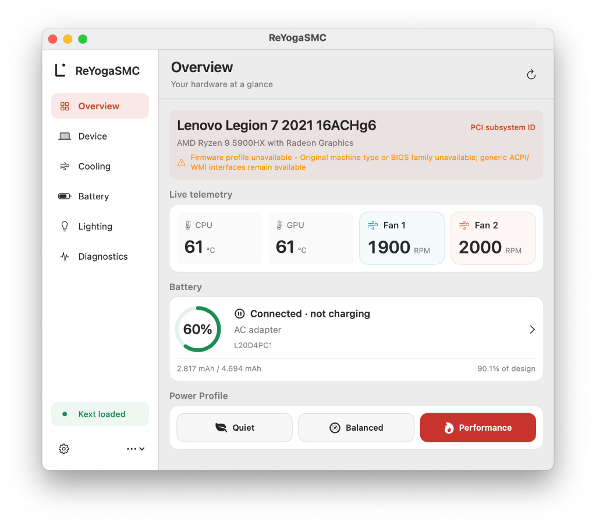
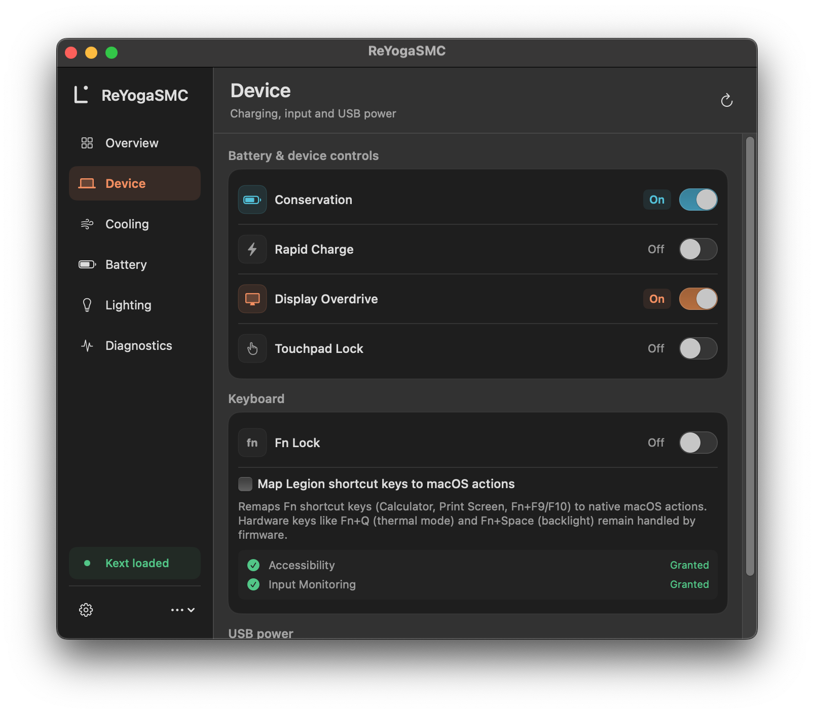
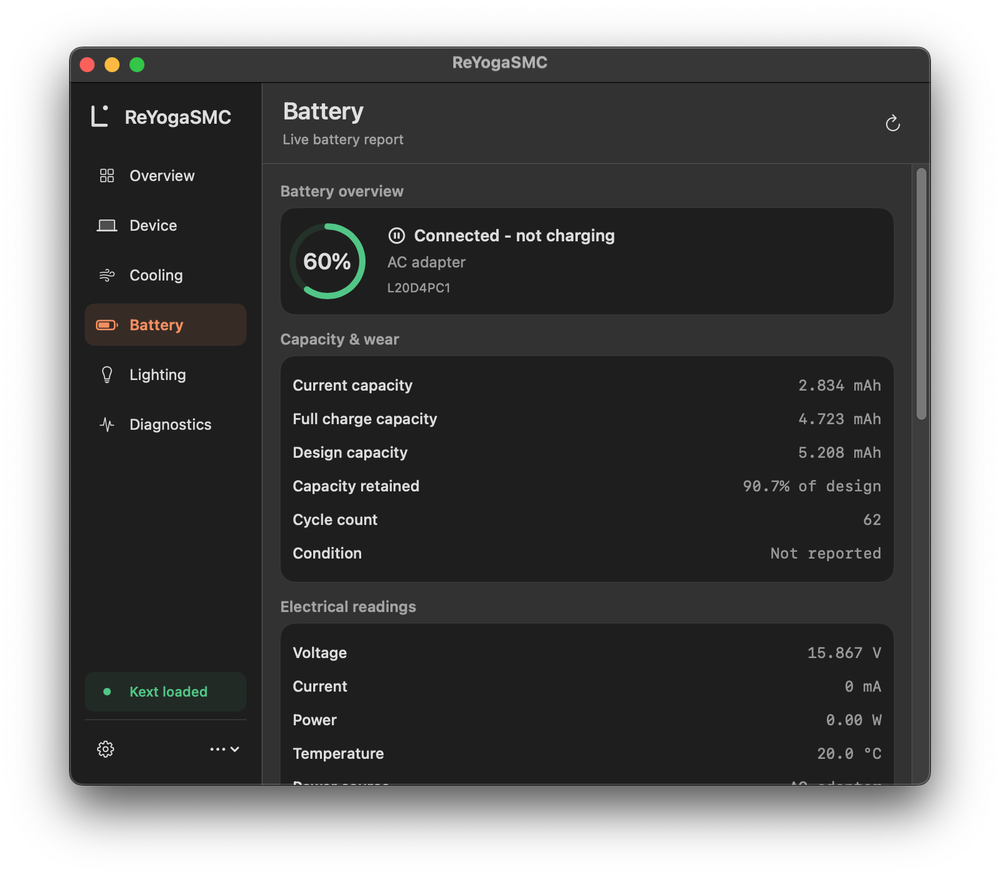
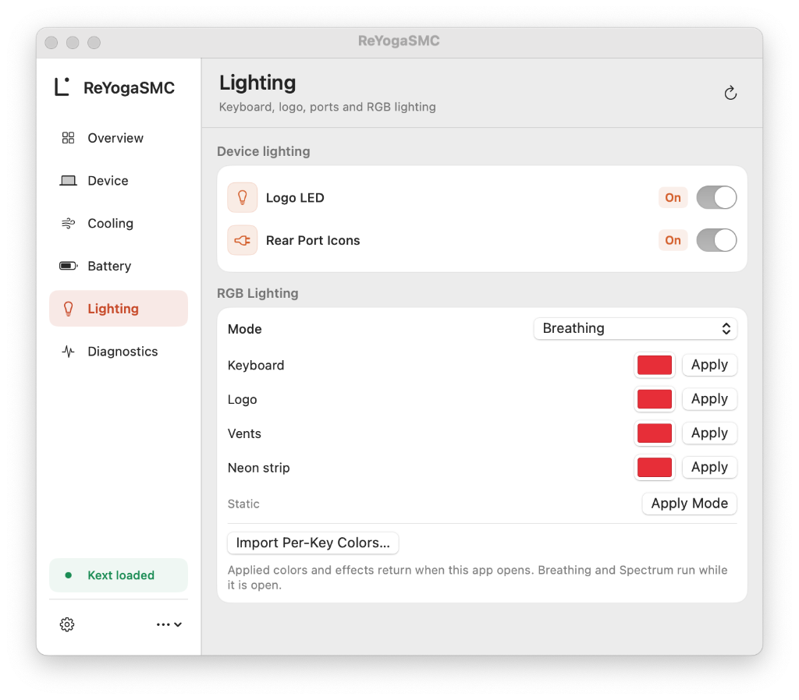
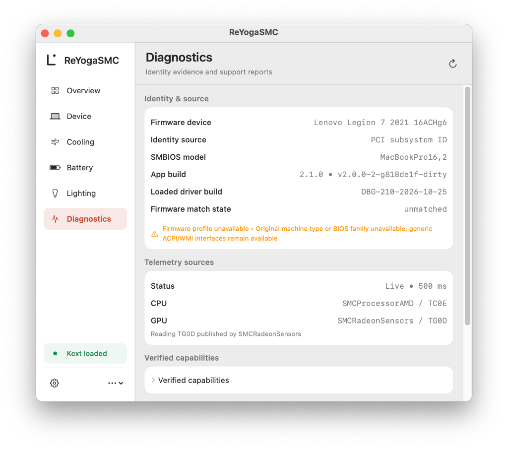
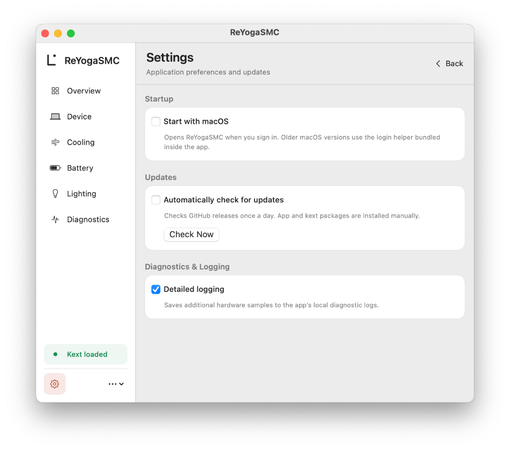

<div align="center">

<picture>
  <source media="(prefers-color-scheme: dark)" srcset="Assets/Brand/readme-dark.svg">
  
</picture>

[](https://github.com/hoaug-tran/ReYogaSMC/actions/workflows/main.yml)
[](https://github.com/hoaug-tran/ReYogaSMC/releases/latest)
[](LICENSE)

ACPI/WMI hardware controls and VirtualSMC sensors for Lenovo Hackintosh laptops, with a macOS companion app and HP WMI sensor/event support.

[Download](https://github.com/hoaug-tran/ReYogaSMC/releases/latest) · [Install](#installation) · [Hardware support](#hardware-support) · [Troubleshooting](#troubleshooting) · [Changelog](Changelog.md)

</div>

<p align="center">
  <a href="Assets/Screenshots/overview.png"></a>
</p>

ReYogaSMC is a fork of [YogaSMC 1.5.3](https://github.com/zhen-zen/YogaSMC/releases/tag/1.5.3) by [Zhen](https://github.com/zhen-zen), continuing its work on laptop sensors, hardware controls and hotkeys for macOS.

## Installation

Requires **macOS 11 (Big Sur) or newer** and OpenCore.

> [!WARNING]
> **Upgrading from YogaSMC or ReYogaSMC 2.0.0:**
> Do not load `YogaSMC.kext` or `ReYogaSMCAlter.kext` alongside `ReYogaSMC.kext`. Before installing, remove any old `YogaSMC*.kext` / `ReYogaSMCAlter.kext` entries from `EFI/OC/Kexts` and `config.plist`, and delete `/Applications/YogaSMCNC.app`, `/Applications/ReYogaSMCNC.app`, and `/Library/PreferencePanes/YogaSMCPane.prefPane` so old background helpers do not conflict with `ReYogaSMC.app`.

### 1. Download packages

Download the latest release from [GitHub Releases](https://github.com/hoaug-tran/ReYogaSMC/releases/latest) or from a completed [Actions run](https://github.com/hoaug-tran/ReYogaSMC/actions/workflows/main.yml):

| File | Contents | Usage |
| :--- | :--- | :--- |
| `ReYogaSMC-<version>-RELEASE.zip` | `ReYogaSMC.kext` | Daily-use kext for `EFI/OC/Kexts` |
| `ReYogaSMC-<version>-DEBUG.zip` | `ReYogaSMC.kext` | Debug kext with verbose kernel logging |
| `ReYogaSMC-App-<version>-RELEASE.zip` | `ReYogaSMC.app` | macOS app with bundled `ReYogaSMCHelper.app` |

Check `SHA256SUMS.txt` on the release page to verify the downloaded archives.

### 2. Load kexts in OpenCore

Copy `ReYogaSMC.kext` to `EFI/OC/Kexts` and order `Kernel -> Add` in `config.plist` so dependencies load first:

1. `Lilu.kext`
2. `VirtualSMC.kext`
3. `ReYogaSMC.kext`

CPU/GPU sensor plugins are optional temperature sources. Load them after their dependencies; they are not required for ReYogaSMC hotkeys or battery controls.

> [!IMPORTANT]
> Release and CI kexts are unsigned; the app and embedded helper are ad-hoc signed. Keep a working recovery EFI on a USB drive when updating kexts.

### 3. Install the app

1. Copy `ReYogaSMC.app` to `/Applications`.
2. Restart macOS and open `/Applications/ReYogaSMC.app`.
3. Open **Diagnostics** to check your profile match state, active sensor sources, and available controls before changing hardware settings.

## Features

| Interface | Available functions |
| :--- | :--- |
| ThinkPad HKEY | Fn hotkeys, Fn lock, backlight, charge thresholds, DYTC thermal profiles, mute LEDs and EC fan control |
| IdeaPad, Yoga, Legion and LOQ ACPI/WMI | Conservation mode, rapid charge, thermal profiles, fan readings, backlight, USB power and supported device controls |
| Legion Game Zone WMI | Full-speed fan toggle, opt-in CPU power limits, display overdrive, touchpad/Win key lock and supported logo/port lights |
| HP WMI and Intel HID | Mapped HP sensor/event interfaces and Intel HID hotkeys; support depends on the interface exposed |
| AppleSmartBattery and AppleSMC | Battery capacity, health, electrical readings and available CPU/GPU temperatures |
| ITE c968 USB RGB (`048d:c968`) | Lighting modes, brightness, zone colors and per-key color import |

The app has Overview, Device, Cooling, Battery, Lighting and Diagnostics pages, plus Settings. English and Vietnamese are available. Battery, SMC and supported USB RGB access remain usable without the VPC kext connection. Update checks notify you of releases; installation is manual. Saved RGB settings are reapplied when the app opens; software-driven Breathing and Spectrum effects run while it is open.

<details>
<summary>App screenshots - click an image to view it at full size</summary>

The screenshots below were captured on a Lenovo Legion 7 16ACHg6. Other machines may expose different controls.

| Device controls | Battery readings |
| :---: | :---: |
| [](Assets/Screenshots/device.png) | [](Assets/Screenshots/battery.png) |
| **Lighting** | **Diagnostics** |
| [](Assets/Screenshots/lighting.png) | [](Assets/Screenshots/diagnostics.png) |

<p align="center">
  <a href="Assets/Screenshots/settings.png"></a>
</p>

</details>

## Hardware support

**ThinkPad:** HKEY methods provide controls without an IdeaPad/Legion JSON profile. Fan control also needs the correct EC read/write methods. Each feature is checked separately.

**IdeaPad and Yoga:** Generic ACPI controls work when firmware provides the expected methods. Game Zone WMI is not required for basic battery, keyboard or USB controls.

**Legion, LOQ and other profile-based models:** Native EC sensor reads require matching firmware identity. A profile match does not grant write permission. All current ACPI profiles leave manual fan-curve writes disabled; ordinary firmware thermal modes and full-speed fan control are separate interfaces.

**HP:** Support is limited to implemented WMI sensor/event interfaces and mapped sensor names. It does not include every HP generation or the separate Elite x2 brightness interface.

<details>
<summary>Native ACPI profile catalog - 21 profiles</summary>

The entries below match the JSON catalog. They do not certify every listed machine/BIOS combination. See [profile requirements](HardwareProfiles/README.md) for native telemetry, bridge generation and write validation.

| Profile ID | Model name | Machine types | BIOS families | EC path |
| :--- | :--- | :--- | :--- | :--- |
| `ideapad-gaming3-gen5` | Lenovo IdeaPad Gaming 3 15ARH05 | `82EY` | `FCCN` | `\_SB.PCI0.LPC0.EC0` |
| `ideapad-gaming3-gen6` | Lenovo IdeaPad Gaming 3 15ACH6 | `82K2`, `82K1` | `H3CN` | `\_SB.PCI0.LPC0.EC0` |
| `legion-pro5-gen8-arh` | Lenovo Legion Pro 5 16ARX8 | `82WM`, `82WQ` | `LPCN` | `\_SB.PCI0.LPC0.EC0` |
| `legion-pro5-gen8-irx` | Lenovo Legion Pro 5 16IRX8 | `82WK`, `82WL` | `KWCN` | `\_SB.PC00.LPCB.EC0` |
| `legion-pro5-gen9-irx` | Lenovo Legion Pro 5 16IRX9 | `83DF` | `N2CN` | `\_SB.PC00.LPCB.EC0` |
| `legion-pro7-gen8-irx` | Lenovo Legion Pro 7 16IRX8H | `82WQ`, `82WR` | `KWCN` | `\_SB.PC00.LPCB.EC0` |
| `legion-pro7-gen9-irx` | Lenovo Legion Pro 7 16IRX9 | `83FD` | `NSCN` | `\_SB.PC00.LPCB.EC0` |
| `legion5-gen5-ach` | Lenovo Legion 5 15ARH05 | `82B5`, `82B1`, `82EY`, `82GN` | `EUCN`, `FSCN` | `\_SB.PCI0.LPC0.EC0` |
| `legion5-gen5-imh` | Lenovo Legion 5 15IMH05 | `81Y6`, `82AU`, `82B3`, `81Y8` | `EFCN`, `E9CN` | `\_SB.PCI0.LPC0.EC0` |
| `legion5-gen6-ach` | Lenovo Legion 5 15ACH6 | `82JW`, `82JU`, `82NW` | `GKCN`, `HHCN` | `\_SB.PCI0.LPC0.EC0` |
| `legion5-gen7-arh` | Lenovo Legion 5 15ARH7 | `82RE`, `82RD` | `JUCN`, `K9CN` | `\_SB.PCI0.LPC0.EC0` |
| `legion5pro-gen6-ach` | Lenovo Legion 5 Pro 16ACH6H | `82JQ`, `82JS` | `GKCN` | `\_SB.PCI0.LPC0.EC0` |
| `legion5pro-gen7-iah` | Lenovo Legion 5 Pro 16IAH7H | `82RF`, `82RG` | `J2CN`, `KFCN` | `\_SB.PC00.LPCB.EC0` |
| `legion7-16achg6-gkcn` | Lenovo Legion 7 2021 16ACHg6 | `82N6` | `GKCN` | `\_SB.PCI0.LPC0.EC0` |
| `legion7-gen5-imh` | Lenovo Legion 7 15IMH05 | `81YT`, `81YU` | `E9CN` | `\_SB.PCI0.LPC0.EC0` |
| `legion7-gen6-ith` | Lenovo Legion 7 16ITHg6 | `82K6` | `H1CN` | `\_SB.PC00.LPCB.EC0` |
| `legion7-gen7-arh` | Lenovo Legion 7 16ARHA7 | `82UH` | `K9CN` | `\_SB.PCI0.LPC0.EC0` |
| `loq-gen8-aph` | Lenovo LOQ 15APH8 | `82XT` | `LYCN` | `\_SB.PCI0.LPC0.EC0` |
| `loq-gen8-irh` | Lenovo LOQ 15IRH8 | `82XV`, `82XW`, `82XU` | `LZCN` | `\_SB.PC00.LPCB.EC0` |
| `loq-gen9-ahp` | Lenovo LOQ 15AHP9 | `83DX`, `83DV`, `83JC` | `NECN` | `\_SB.PCI0.LPC0.EC0` |
| `yoga-slim7-gen5` | Lenovo Yoga Slim 7 14ARE05 | `82A2`, `82A8` | `DMCN`, `EMCN` | `\_SB.PCI0.LPC0.EC0` |

</details>

The driver checks DSDT identity and a unique machine-type or declared PCI subsystem match. Conflicting identities disable model-specific reads; independently available ACPI/WMI controls remain usable. See [compatibility](Docs/compatibility.md) for matching rules, sensor formats and failure behavior.

Known limits:

- T490 BIOS 1.85 uses the PSC thermal interface addressed by the fix. The updated build still needs on-machine validation of thermal modes, Fn+F10, login registration, performance and sleep/wake.
- Some X1 Carbon Gen 6 firmware rejects Quiet. Older MMC firmware may hide its active profile during lap mode; polling does not change lap mode to reveal it.
- A missing firmware interface cannot be supplied by reusing another laptop's register offsets. Removing the DYTC event feedback path does not establish the cause of a graphics panic.

<details>
<summary>Temperature sources and optional sensor plugins</summary>

The app preserves fractional readings and displays one decimal, such as `55.5 °C`. A sensor that reports only whole degrees appears as `55.0 °C`.

The app prefers valid CPU/GPU readings from `AppleSMC` and falls back to driver firmware readings (`CPUT`, `GPUT` or Game Zone WMI). Available sources include:

| Sensor | Kext or firmware source | SMC keys / firmware fields | Notes |
| :--- | :--- | :--- | :--- |
| **AMD Ryzen CPU** | [**SMCProcessorAMD.kext**](https://github.com/trulyspinach/SMCAMDProcessor) | `TC0E`, `TC0P`, `TC0D`, `TC0F` | Needed on AMD Ryzen laptops when ACPI EC `CPUT` or WMI CPU temperature is unavailable |
| **Intel CPU** | [**SMCProcessor.kext**](https://github.com/acidanthera/VirtualSMC) | `TC0P`, `TC0D`, `TC0C`, `TC1C`, `TCSA` | Included in the official VirtualSMC release archive |
| **AMD Radeon iGPU / dGPU** | [**SMCRadeonSensors.kext**](https://github.com/ChefKissInc/SMCRadeonSensors) | `TG0D`, `TG0P`, `TG0E` | Needed to read AMD Radeon iGPU and dGPU temperatures through `AppleSMC` |
| **NVIDIA dGPU** | Firmware EC / WMI | `GPUT` | Depends on firmware and whether the GPU is powered |

A powered-off GPU may have no valid temperature source. Zero or invalid readings are shown as unavailable; installing a graphics driver does not establish EC sensor support.

See [compatibility](Docs/compatibility.md#readings-and-unavailable-controls) for stale readings and unavailable sensors.

</details>

## Troubleshooting

<details>
<summary>CPU or GPU temperature shows Unavailable</summary>

- **AMD CPU temperature missing:** Load `SMCProcessorAMD.kext` after `VirtualSMC.kext`. Check **Diagnostics → Telemetry sources** to confirm `CPU Temperature` uses `SMCProcessorAMD / TC0E` (or `TC0P`).
- **AMD GPU temperature missing:** Load `SMCRadeonSensors.kext`. Check **Diagnostics → Telemetry sources** to confirm `GPU Temperature` uses `SMCRadeonSensors / TG0D`.
- **NVIDIA dGPU temperature missing:** Check whether the GPU is powered and whether firmware supplies a valid `GPUT`/WMI reading. A missing firmware sensor cannot be supplied by ReYogaSMC.

</details>

<details>
<summary>Profile match state shows identity_unavailable or conflict</summary>

- OpenCore setups that spoof a Mac SMBIOS (`MacBookPro16,1`, etc.) replace SMBIOS Type 0 and Type 1 strings unless original OEM fields are preserved.
- On models with verified Lenovo PCI subsystem IDs in `HardwareProfiles/` (such as Legion 7 16ACHg6), `ReYogaSMC` matches the board's PCI subsystem ID (`17aa:xxxx`) together with the DSDT OEM table ID (`pci_matched`).
- For other models in `HardwareProfiles/` when SMBIOS is spoofed, expose the original 4-character Lenovo machine type and BIOS family prefix in `/efi/platform` or NVRAM (`OEMProduct` and `OEMBIOSVersion`), or export diagnostics so your DSDT SHA-256 digest can be reviewed.
- If `ProfileMatchState` is `conflict`, two identity sources on the system disagree (for example, an injected `OEMProduct` does not match the board's PCI subsystem ID). Remove the mismatched property.

</details>

<details>
<summary>Manual fan minimum RPM is disabled on IdeaPad or Legion</summary>

- Available ACPI/WMI interfaces may provide RPM readings, preset thermal modes and a separate full-speed fan toggle. These do not establish a safe generic manual RPM floor register.
- Manual fan minimum RPM controls (`Fan1TargetRPM`, `Fan2TargetRPM`) are enabled only when a reviewed v2 ACPI bridge (`RYID = 0x52590102`) with hardware-validated writes (`RYVW = 1`) matches your exact DSDT SHA-256 fingerprint.

</details>

<details>
<summary>CPU power limits are locked after switching thermal mode</summary>

- When `CPUBoostPower` or `CPUSustainedPower` is changed (with `-reycpupower` enabled), the driver records the active thermal profile in `CPUPowerPendingProfile`.
- If the thermal profile changes outside the app (such as pressing `Fn+Q`), the driver locks power-limit edits until you switch back to the recorded profile and restore its saved values.

</details>

<details>
<summary>ThinkPad fan control and ACPI bridge generation</summary>

- ThinkPad laptops do not use `HardwareProfiles/*.json` or `SSDT-ReYoga` bridges. The app hides **Generate ACPI bridge** when connected to ThinkVPC.
- ThinkPad fan speeds and manual levels (`Auto`, `Full Speed`, and levels `1`–`7`) are controlled in **Cooling → ThinkPad Fans** through the `ThinkFanProtocolVersion = 1` user client (`kRYSMCUCThinkFan`), which requires a `PNP0C09` EC device with `RW` access.
- If EC access is Basic or RO, check the real EC path and the `RE1B`/`WE1B` methods. Adapt [SSDT-ECRW.dsl](ReYogaSMC/SSDTSample/SSDT-ECRW.dsl) only after checking existing battery patches for field/method conflicts. ECEnabler alone does not add these methods.
- On dual-fan ThinkPads, the driver writes EC register `0x31` to select the second fan and restores `0x31` before finishing. If restoring `0x31` fails during a transaction, the driver sets `ThinkFanAccessFailed = true` and disables further fan access until reboot so later EC reads cannot hit the wrong bank.

</details>

<details>
<summary>Hotkeys, Fn keys, Bluetooth toggle, or Caps Lock OSD do not work</summary>

- Keep `ReYogaSMC.app` in `/Applications/ReYogaSMC.app`.
- Enable **Accessibility** and **Input Monitoring** for `ReYogaSMC` in **System Settings → Privacy & Security** (and allow **Bluetooth** access when using the `Fn+F10` Bluetooth hotkey).
- Because ad-hoc signed builds change their signature when rebuilt or updated, macOS may require privacy approval again after replacing the app. Remove `ReYogaSMC` from **Accessibility** and **Input Monitoring** (or toggle both switches off and back on), then reopen the app.

</details>

<details>
<summary>Start with macOS shows Approve ReYogaSMC in System Settings → Login Items</summary>

- On macOS 13 and newer, `SMAppService` registers the login item and waits for user approval in **System Settings → General → Login Items**. `Scripts/build.sh` and `Scripts/package.sh` ad-hoc sign `ReYogaSMC.app` to avoid shipping an unsigned bundle. Ad-hoc signing alone does not establish that login registration or permission persistence works on every macOS release. If registration still fails, install the app in `/Applications`, check Login Items approval, and collect diagnostics; use `Scripts/sign-app.sh` with a persistent signing identity for updates.

</details>

<details>
<summary>Windows hardware tool (ReYoga.cmd) reports that EC read is unavailable</summary>

- Windows blocks raw I/O port `0x62`/`0x66` access from unprivileged processes. Collecting a live 256-byte EC snapshot on Windows (`--ec-read`) is optional and requires the signed [PawnIO driver](https://pawnio.eu/) installed with Administrator privileges.
- Standard ACPI table dumps (`DSDT.aml`, `SSDT*.aml`) and WMI inventory on Windows work without PawnIO or EC read access.

</details>

## Boot arguments

Add any of the following flags to `boot-args` in `config.plist` when troubleshooting or enabling opt-in features:

| Boot argument | Description |
| :--- | :--- |
| `-reysafe` | Start `ReYogaSMC.kext` in safe mode: skip ACPI/WMI hardware probes and block all firmware writes |
| `-reynobridge` | Disable native ACPI profile matching and `RYID` SSDT bridge discovery; use generic ACPI/WMI only |
| `-reynowmi` | Disable vendor WMI probing, including IdeaVPC and HP WMI interfaces |
| `-reycpupower` | Enable opt-in WMI CPU boost and sustained power-limit controls on supported Legion firmware |
| `-reyfanstop` | Allow ThinkPad manual fan level `0` (`0 RPM`) through `kRYSMCUCThinkFan` |
| `-reytrace` | Log ACPI/WMI method entry and exit markers (capped at 128 WMI calls) |

## Diagnostics and support

1. Open **ReYogaSMC → Diagnostics** and click **Export diagnostics** to save a local ZIP containing driver properties, sensor status, recent app logs, and `DSDT.aml` (when exported by the driver).
2. You can also run the collection tool from a source checkout (requires Python 3.9+):
   - **macOS:** `./ReYoga.command`
   - **Windows:** `ReYoga.cmd`
3. Attach the ZIP to a [device-support issue](https://github.com/hoaug-tran/ReYogaSMC/issues/new/choose) with your laptop model, BIOS version, and macOS version. See the [hardware tool guide](Docs/hardware-tool.md) for command-line flags.

> [!TIP]
> Diagnostic exports stay on your machine until you share them. Check the ZIP contents before posting publicly, as ACPI tables and SMBIOS data may contain serial numbers.

## Build from source

Install Xcode and its command-line tools, then run:

```sh
bash Scripts/bootstrap.sh
bash Scripts/build.sh Debug
bash Scripts/build.sh Release
bash Scripts/package.sh Release
```

- `Scripts/build.sh` and `Scripts/package.sh` run as a normal user without `sudo`.
- Locked dependency versions (`MacKernelSDK`, `Lilu`, `VirtualSMC`) and SHA-256 checksums are stored in [`Scripts/dependencies.json`](Scripts/dependencies.json).
- After editing `HardwareProfiles/*.json`, regenerate `ReYogaSMC/ReYogaFirmwareProfiles.hpp`:
  ```sh
  python3 Scripts/generate_firmware_profiles.py
  ```
- Run the test suite:
  ```sh
  python3 -B -m unittest discover -s Tests -v
  ```
- Sign the app with a local or Developer ID certificate using the same identity for subsequent builds to reduce repeated privacy prompts:
  ```sh
  bash Scripts/sign-app.sh 'Developer ID Application: Your Name (TEAMID)' build/Release
  ```

## Credits and license

- Original [YogaSMC](https://github.com/zhen-zen/YogaSMC) by **Zhen**.
- Licensed under [GPL v2.0](LICENSE); original copyright and license notices are retained.
- Protocol references: Linux [`thinkpad_acpi`](https://github.com/torvalds/linux/blob/master/drivers/platform/x86/lenovo/thinkpad_acpi.c) and [`ideapad-laptop`](https://github.com/torvalds/linux/blob/master/drivers/platform/x86/lenovo/ideapad-laptop.c), [LenovoLegionLinux](https://github.com/johnfanv2/LenovoLegionLinux), [LenovoLegionToolkit](https://github.com/BartoszCichecki/LenovoLegionToolkit), and [OpenRGB](https://gitlab.com/CalcProgrammer1/OpenRGB).
- Kernel SDK and SMC plugins by [Acidanthera](https://github.com/acidanthera), [SMCAMDProcessor](https://github.com/trulyspinach/SMCAMDProcessor), [SMCRadeonSensors](https://github.com/ChefKissInc/SMCRadeonSensors), and [ACPICA](https://github.com/open-acpica/acpica).
